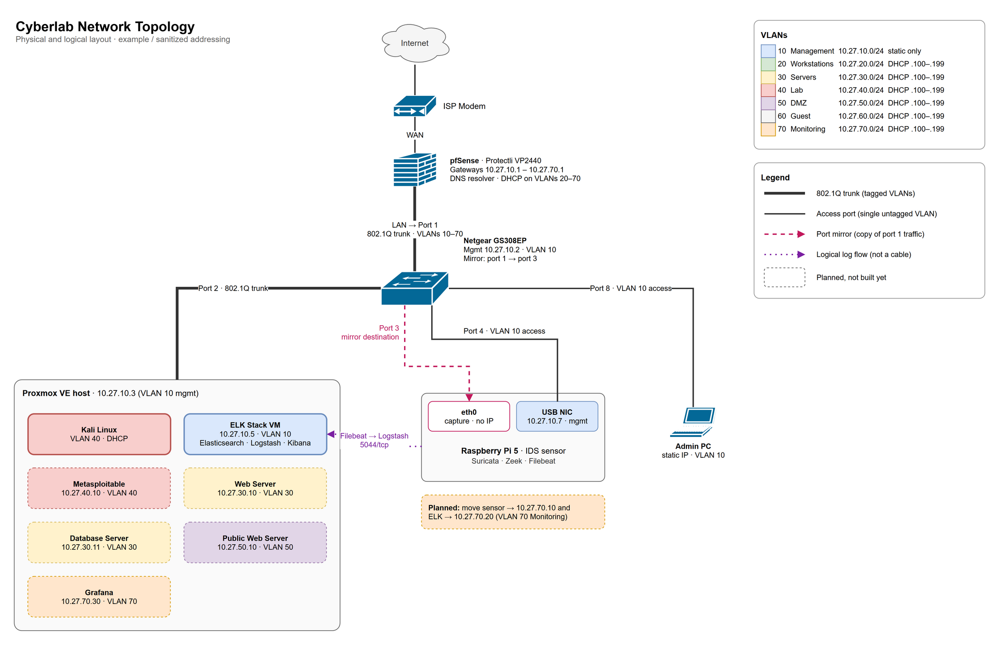

# 🏗️ 01 - Network Architecture

## Objective
Document the physical and logical network architecture, including devices used, physical connections, and network topology

## Hardware
| Device | Purpose |
|--------|---------|
| Modem | Internet Access |
| Protectli Vault VP2440 | Firewall / Router |
| Netgear GS308EP | Managed Switch |
| Proxmox Host | Virtualization Server |
| Raspberry Pi | Intrusion Detection System (IDS) |
| Dell Laptop | Admin PC |

## Physical Connections
| From | To | Notes |
|------|----|-------|
| Modem | Protectli WAN | Internet access |
| Protectli LAN | Switch Port 1 | Trunk / VLAN tagging |
| Proxmox Host | Switch port 2 | VLAN trunk |
| Raspberry Pi (eth0) | Switch port 3 | Capture: mirror destination, no IP |
| Raspberry Pi (USB NIC) | Switch port 4 | Management: VLAN 10 access, 10.27.10.7 |
| Admin PC | Switch port 8 | Temporary management |

## Logical Network Design

| Network | VLAN | Subnet | Purpose |
|---------|------|--------|---------|
| Management | 10 | 10.27.10.0/24 | Firewall, Switch, Proxmox, Admin access |
| Workstations | 20 | 10.27.20.0/24 | Normal users, primary internal network |
| Servers | 30 | 10.27.30.0/24 | AD, file servers, DNS, internal services |
| Lab | 40 | 10.27.40.0/24 | Kali, malware analysis, attack VMs |
| DMZ | 50 | 10.27.50.0/24 | Public-facing services |
| Guest | 60 | 10.27.60.0/24 | Guest internet access |
| Monitoring | 70 | 10.27.70.0/24 | IDS, Suricata, monitoring, logging |

## Steps taken
- Listed all hardware devices and their purpose
- Mapped physical connections between each device
- Drafted guidelines for VLANs, subnetting, and future purpose

1. Connected Protectli Vault WAN interface to modem
2. Connected Protectli Vault LAN interface to Netgear switch port 1
3. Connected Proxmox host to Netgear switch port 2
4. Connected Raspberry Pi eth0 to Netgear switch port 3
5. Connected Raspberry Pi USB-Ethernet adapter to Netgear switch port 4
6. Connected Admin PC to Netgear switch port 8

## Network Diagram

> Source file: [`network-diagram.drawio`](network-diagram.drawio) (open with [draw.io](https://www.drawio.com/) to edit, then re-export the PNG)

## Notes & Observations
1. Separating physical and logical connections and planning documentation made setup easier than winging it in v1
2. Creating a network diagram allowed for a smooth and easy setup
3. Determining switch ports beforehand helped maintain logical flow (prioritizing firewall in switch port 1)
4. Planning logical design helped outline objectives and network segmentation

## ➡️ Next Up
[**02 - IP Schemes:** Plan IP ranges and VLANs](<02 - IP Schemes.md>)